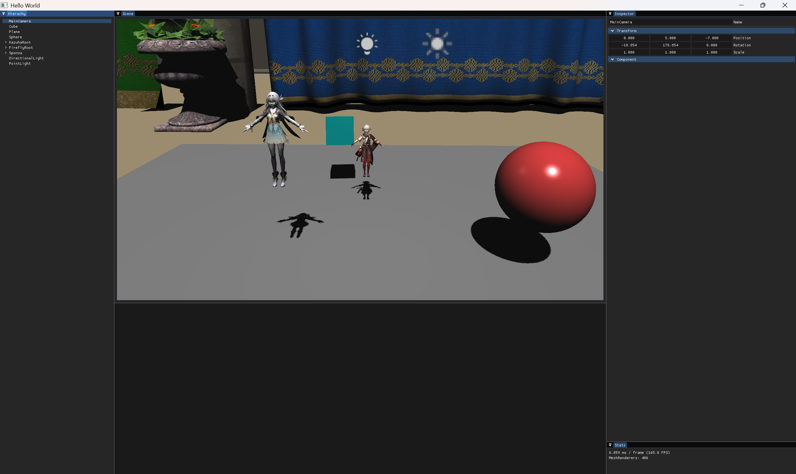
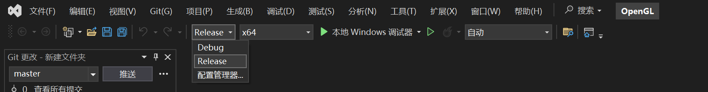
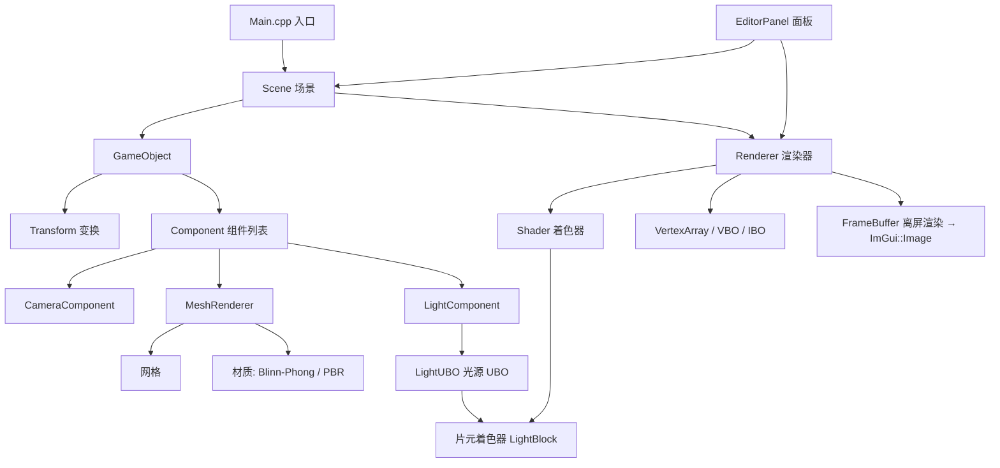

# OpenGL 手动搭建渲染引擎

一个基于 **OpenGL 4.2 Core** 手写实现的轻量级 3D 渲染引擎项目（不使用现成引擎，纯手动管理 OpenGL 状态与资源），使用 **C++20** 编写。项目采用类似 Unity 的 **GameObject-Component（ECS 变体）** 架构，支持场景管理、多种材质、多光源（UBO 批量上传）、assimp 模型加载，以及基于 ImGui **Docking** 的编辑器界面（Hierarchy / Inspector / Scene 视图 / Stats）。



---

## 功能特性

- 1. **GameObject-Component 架构**
  - `GameObject` 支持父子层级、Transform（位置 / 旋转 / 缩放）
  - 基于模板 + `std::derived_from` 约束的组件添加 / 查询（`AddComponent<T>` / `GetComponent<T>`）
  - `Component` 生命周期钩子：`OnAttach`、`OnUpdate`、`OnRender`
- 2. **场景管理（Scene）**
  - 创建 / 销毁 / 按名称查找 GameObject
  - 快捷创建相机、立方体、平面、球体、方向光、点光源
  - 支持 `assimp` 加载外部模型（如 FBX）
- 3. **材质系统（Material）**
  - 抽象基类 `Material`，派生 `BlinnPhongMaterial`（Blinn-Phong 光照）、`PBRMaterial`（PBR 光照）
  - 材质模板方法可传入任意参数组合
- 4. **多光源系统（Light）**
  - 方向光（Directional Light）、点光源（Point Light）
  - 通过 **UBO（Uniform Buffer Object）** 批量上传最多 `MAXLIGHTS = 16` 个光源，单次 `glBufferSubData` 高效更新
- 5. **编辑器界面（ImGui Docking）+ Scene 视图**
  - 使用 ImGui **docking 分支**，`DockSpace` 固定停靠布局：左 Hierarchy / 中 Scene / 右 Inspector / 下 Stats
  - **Hierarchy**：按 Transform 父子层级递归展示场景物体，点击选中、右键 Delete（走延迟销毁队列，不会在遍历中 erase）
  - **Inspector**：物体改名、Transform（位置 / 欧拉角 / 缩放）编辑；各 Component 通过虚函数 `DrawInspectorGUI()` 自绘制参数
  - **Scene 视图**：场景先渲染到离屏 `FrameBuffer`，再用 `ImGui::Image` 显示到面板；面板缩放时同步 `glViewport`、FBO `Resize` 与相机宽高比
  - **Stats**：FPS / 每帧耗时 / MeshRenderer 数量
- 6. **调试友好**
  - `GLCall` / `GLClearError` / `GLPrintError` + `ASSERT` 宏，OpenGL 错误自动定位到文件与行号并触发断点
- 7. **纯手写资源管线**：`VertexBuffer` / `IndexBuffer` / `VertexArray` / `Shader` / `Texture` 封装
- 8. **模型加载（assimp）**：加载 FBX 等外部模型，支持多子网格拆分与贴图自动加载（拼接模型相对路径解决 assimp 相对路径问题）
- 9. **光源图标 Billboard（公告牌）**：光源标记图标四边形始终面向相机，区分方向光 / 点光源，视觉上直观定位光源
- 10. **阴影（Shadow Mapping）**：方向光深度 Pass 生成阴影贴图（复用通用 `FrameBuffer`，深度专用），主 Pass 将片元世界坐标变换到光源空间（`u_LightVP`）采样，并做 3×3 **PCF** 软化边缘

---

## 技术栈与依赖

| 依赖 | 用途 | 说明 |
| --- | --- | --- |
| [GLFW](https://www.glfw.org/) | 窗口与输入 | `Dependencies/GLFW` |
| [GLEW](https://glew.sourceforge.net/) | OpenGL 扩展加载 | 静态链接（`GLEW_STATIC`），需最先 `#include` |
| [assimp](https://github.com/assimp/assimp) | 模型加载 | `Dependencies/assimp` |
| [glm](https://github.com/g-truc/glm) | 数学库（矩阵 / 向量） | `Scripts/vendor/glm`（头文件库） |
| [ImGui](https://github.com/ocornut/imgui) | 编辑器 UI | `Scripts/vendor/imgui`（**docking 分支** v1.93.1 WIP，提供停靠布局） |
| [stb_image](https://github.com/nothings/stb) | 纹理加载 | `Scripts/vendor/stb_image` |

- **语言 / 标准**：C++20
- **图形 API**：OpenGL 4.2 Core（顶点着色器 `#version 330`，片元着色器 `#version 420`）
- **构建系统**：CMake（三平台通用）或 Visual Studio `.sln`
- **编译器**：MSVC（Windows）/ GCC / Clang（Linux / macOS）

---

## 项目结构

```
OpenGL(Manually)/
├── CMakeLists.txt                 # CMake 构建脚本（三平台通用）
├── OpenGL.sln                     # VS 解决方案（Windows 直接打开用）
├── Dependencies/                  # 第三方库（GLFW / GLEW / assimp 的头文件与 Windows 预编译 .lib）
├── docs/                          # 设计笔记（如欧拉角反解 / EulerHint 推导）
├── OpenGL/
│   ├── OpenGL.sln / OpenGL.vcxproj # VS 工程文件
│   ├── build/                      # VS 构建输出
│   ├── Resources/
│   │   ├── Models/                 # 模型资源（Firefly / Kazuha 等）
│   │   └── Textures/               # 纹理资源
│   └── Scripts/
│       ├── Main.cpp                # 程序入口：窗口、场景搭建、主循环
│       ├── Renderer.h / Renderer.cpp       # 渲染器封装 + GLCall 调试宏
│       ├── Render/FrameBuffer.h    # 通用离屏帧缓冲（颜色/深度附件、Bind/Unbind、Resize）
│       ├── EditorPanel/EditorPanel.h # Hierarchy / Inspector / Stats 面板
│       ├── Shader.h / Shader.cpp           # 着色器编译 / 链接 / Uniform 设置
│       ├── Texture.h / Texture.cpp         # 纹理封装
│       ├── VertexBuffer / IndexBuffer / VertexArray / VertexBufferLayout   # 缓冲区与 VAO
│       ├── Components/             # 组件系统
│       │   ├── Component.h / Component.cpp # 组件基类（生命周期钩子）
│       │   ├── Transform.h         # 变换（位置 / 欧拉角 / 缩放）
│       │   ├── CameraComponent.h   # 相机（透视投影 / 视图矩阵）
│       │   ├── LightComponent.h    # 光源组件
│       │   ├── Mesh.h / Mesh.cpp   # 网格（立方体 / 平面 / 球体程序化生成）
│       │   ├── MeshRenderer.h      # 网格渲染组件
│       │   └── Materials/          # 材质系统
│       │       ├── Material.h          # 材质基类
│       │       ├── BlinnPhongMaterial.h # Blinn-Phong 材质
│       │       └── PBRMaterial.h       # PBR 材质
│       ├── GameObjects/
│       │   ├── GameObject.h        # 游戏物体（父子层级 + 组件管理）
│       │   └── Model/              # Model.h / Model.cpp（assimp 模型加载）
│       ├── Light/
│       │   ├── LightData.h         # 光源数据结构
│       │   └── LightUBO.h          # 光源 UBO（std140 布局批量上传）
│       ├── Scene/
│       │   └── Scene.h             # 场景（物体管理 + 快捷创建）
│       ├── Shadow/
│       │   └── ShadowMap.h         # 阴影贴图（FBO + 深度纹理，保存/恢复视口）
│       ├── Shaders/
│       │   ├── BlinnPhongShaders/  # 主渲染着色器（Blinn-Phong + 多光源 UBO + 阴影采样）
│       │   ├── GizmoShaders/       # 光源图标（Billboard）着色器
│       │   └── ShadowShaders/      # 阴影深度 Pass 着色器
│       └── vendor/                 # 第三方源码（glm / imgui / stb_image）
└── build/                          # CMake 构建输出目录（本地生成，不入版本控制）
```

---

## 环境要求

- 支持 OpenGL 4.2 的显卡驱动
- CMake ≥ 3.20（推荐；也可直接用 Visual Studio 打开 `.sln`）
- 平台与编译器：
  - **Windows**：Visual Studio 2022（含 **C++ 桌面开发** 工作负载，提供 `cl.exe`）
  - **Linux**：GCC ≥ 11 或 Clang ≥ 13，并通过包管理器安装 glfw / glew / assimp 开发包

---

## 构建

推荐使用 **CMake**，一次性 CMakeLists 可在 Windows / Linux / macOS 上通用；Windows 下也可以用 Visual Studio 直接打开 `.sln` 或在 VS Code 里按 `Ctrl+Shift+B` 跑任务。

### 方式一：CMake（推荐，三平台通用）

#### Windows

```powershell
# 项目根目录 D:\OpenGL
cmake -S . -B build                       # ① 配置：生成 build\OpenGL.sln
cmake --build build --config Release      # ② 编译 Release
.\build\Release\OpenGL.exe                # ③ 运行（从任意目录都行）
```

- Debug：把 `--config Release` 换成 `--config Debug`，产物在 `build\Debug\`。
- 并行编译：`cmake --build build --config Release -j 8`。
- CMake 不在 PATH 里的话：`winget install Kitware.CMake` 或 `choco install cmake -y --installargs 'ADD_CMAKE_TO_PATH=System'`。

#### Linux

```bash
# Debian / Ubuntu：装依赖
sudo apt install -y build-essential cmake libglfw3-dev libglew-dev libassimp-dev

mkdir build && cd build
cmake ..
make -j$(nproc)
./OpenGL
```

> **WSL 2 下的常见问题**（真实 Linux 一般不会遇到）：
> - **GLEW + Wayland 不兼容**：WSLg 默认同时暴露 Wayland 和 X11；GLFW 会优先选 Wayland+EGL，而 GLEW 只支持 GLX，于是 `glewInit()` 返回 `GLEW_ERROR_NO_GLX_DISPLAY`。本项目在 Main.cpp 里已通过 `glfwInitHint(GLFW_PLATFORM, GLFW_PLATFORM_X11)` 显式走 X11，需要 GLFW ≥ 3.4（Ubuntu 24.04 及以上默认满足）。

> **CMakeLists 的几个特性，减少后续维护负担**
> - 自动递归扫描 `OpenGL/Scripts/` 下所有 `.cpp` / `.h` / `.hpp`，**新增文件/文件夹无需修改 CMakeLists**；配合 `CONFIGURE_DEPENDS`，CMake 会在下次 build 时自动重扫文件树
> - **启动时自动 `chdir`**：生成一个 bootstrap 源文件在静态初始化期切 CWD 到 `OpenGL/Scripts/`，使 `../Resources/...` 这类相对路径生效；因此可从任意目录运行可执行文件
> - 平台适配：Windows 使用仓库内自带的预编译 `.lib`（MSVC `lib-vc2022`）；Linux / macOS 走 `find_package` 使用系统包管理器安装的库

### 方式二：Visual Studio（Windows）

1. 打开根目录 `OpenGL.sln`（或 `OpenGL/OpenGL.sln`）；
2. 选择 `x64` 平台，构建并运行。
3. 注意必须要使用 **Release** 而不是 Debug 进行编译（如图）

### 方式三：VS Code 一键构建（Windows，`Ctrl+Shift+B`）

项目在 `.vscode/tasks.json` 中配置了 MSVC 手动构建任务：

1. 打开工作区 `OpenGL`；（注意**一定**要进入 OpenGL 这个文件夹，保证工作区在正确的位置否则会编译失败）
2. 按 `Ctrl+Shift+B` 执行 **`C/C++: cl.exe 生成 OpenGL.exe`** 任务；
3. 任务通过 `cmd.exe /c` 先调用 `vcvarsall.bat x64` 再执行 `cl.exe`，不依赖终端持久环境；
4. 输出：`OpenGL/build/OpenGL.exe`。

> 注意：
> - **VS 安装路径自动探测**：任务不再硬编码 `vcvarsall.bat` 的绝对路径，而是通过 `vswhere`（`%ProgramFiles(x86)%\Microsoft Visual Studio\Installer\vswhere.exe`）定位本机最新安装且带有 C++ 工具的 VS，再调用其 `vcvarsall.bat`。因此**换机器 / 换 VS 版本 / 换安装盘符都不需要改 `tasks.json`**，只要机器装有 VS 的 C++ 桌面开发工作负载即可。
> - 修改 `tasks.json` 后需 **重载窗口**（`Ctrl+Shift+P` → Reload Window），否则会复用已损坏的任务终端。

---

## 使用说明

启动后程序会：

1. 创建 1920×1080 窗口并初始化 OpenGL 4.x 上下文；
2. 搭建场景：主相机 + 平面（Blinn-Phong）+ 通过 assimp 加载的 `KAZUHA.fbx` / `firefly.fbx` 模型 + 球和立方体 + 方向光 / 点光源；
3. 进入渲染主循环：每帧先执行阴影深度 Pass，随后把主渲染 Pass 渲染到 Scene 的离屏 FBO（采样阴影贴图、绘制光源 Billboard 图标），最后用 `ImGui::Image` 显示到 Scene 面板，并叠加 Hierarchy / Inspector / Stats 面板。

**编辑器面板**

| 面板 | 内容 |
| --- | --- |
| Hierarchy | 树形展示所有根物体及其子物体；左键选中、右键 Delete |
| Inspector | 选中物体的 Name、Transform，以及各 Component 的可编辑参数 |
| Scene | 场景实时渲染结果（FBO 纹理），随面板大小自适应 |
| Stats | FPS、每帧耗时、MeshRenderer 数量 |

**相机操作**：按住鼠标右键进入自由视角（WASD 移动 + 鼠标转向），松开恢复。

**默认场景参数**（可在 `Main.cpp` 中修改 / 取消注释）

- 相机：位置 `(0, 5, -12)`，旋转 `(-20°, 180°, 0°)`（朝 +Z 看向场景）
- 平面：`CreatePlane<BlinnPhongMaterial>("Plane", 20.0f, ...)`
- 模型：`Kazuha`（`-90°, 180°, 0°` 资产轴向修正）、`Firefly`（缩放 0.1）、`Sponza`（缩放 0.1）
- 方向光：`CreateDirectionalLight(...)`，位置 `(0, 5, 7)`，旋转 `(-30°, 0°, 0°)`
- 点光源：`CreatePointLight(...)`，位置 `(0, 5, 0)`

---

## 架构设计



### 核心要点

- **GameObject-Component**：`GameObject` 持有 `Transform` 与 `Component` 列表；`Component` 是抽象基类，通过 `OnAttach / OnUpdate / OnRender` 生命周期钩子与引擎交互；`AddComponent<T>` 使用 C++20 concept 约束确保 `T` 派生自 `Component`。
- **场景（Scene）**：以 `std::unique_ptr<GameObject>` 统一管理生命周期，通过原始指针暴露接口（注意在 `std::move` 前获取指针）。
- **材质与网格分离**：`MeshRenderer` 组合 `Mesh` + `Material`；`Mesh::CreateCube/Plane/Sphere` 程序化生成顶点数据。
- **多光源 UBO**：`LightUBO` 按 `std140` 布局分配 GPU 显存并绑定到 binding point 0；片元着色器 `LightBlock` 中 `Light lights[MAXLIGHTS]` 批量读取，支持方向光 / 点光源（点光源按距离平方衰减）。
- **Transform.h（旋转）**：底层用**四元数**存储；欧拉角只作为编辑层表示，构造顺序为 **ZXY**（与 Unity 一致），因此固有奇点落在 pitch（X）= ±90°。`GetEulerAngles()` 带 **Euler Hint** 缓存：四元数 → 欧拉角有多组等价解（周期解 ±360°k、翻转解 `(180−x, y+180, z+180)`），反解时挑选与上次编辑值最接近的一组，消除拖拽跨越 ±180° / 奇异点时的数值跳变。
- **FrameBuffer**：通用离屏帧缓冲（颜色 + 深度附件）。`Bind/Unbind` 会保存并恢复**此前绑定的 FBO 与视口**，因此阴影 Pass 嵌套在 Scene FBO 内也不会把渲染目标弄丢；`Resize` 按面板尺寸重建附件。Scene 面板与阴影贴图共用这套实现。
- **EditorPanel**：Header-only 的编辑器面板集合。Hierarchy 依据 `Transform::GetChildren()` 递归，只有根节点作为入口（避免重复绘制）；Inspector 用 `PushID(组件指针)` 保证同类型多组件不串 ID；选中指针失效时通过 `Scene::Contains()` 校验，避免悬空引用。
- **Billboard（公告牌）**：光源图标使用一个共用四边形 Mesh，通过 `lookDir`（相机 `-forward`）、`right`、`up` 叉乘构造始终朝向相机的旋转矩阵，实现贴图永远面对相机
- **硬阴影（Shadow Mapping）**：第一趟用 `shadowShader` 从光源视角把场景深度渲染到 `ShadowMap`（FBO + 深度纹理），主渲染时把片元世界坐标变换到光源空间（`u_LightVP`）采样阴影贴图，`currentDepth > closestDepth` 即判定为阴影
- **模型加载**：`Model` 递归处理 assimp 节点树，每个子网格生成一个 `GameObject` + `MeshRenderer`；贴图路径拼接模型目录解决相对路径 / 中文路径导致的加载失败

### 着色器

- **BlinnPhongShaders / vert.shader**（`#version 420`）：模型 → 世界 → 视图 → 裁剪坐标变换，法线经转置逆矩阵变换，输出世界坐标 / 法线 / UV。
- **BlinnPhongShaders / frag.shader**（`#version 420`）：Blinn-Phong 光照模型（环境光 + 漫反射 + 高光），支持最多 16 个光源的 UBO 循环计算，并集成阴影采样（`CaculateShadow`）。
- **GizmoShaders**：光源图标（Billboard）着色器，绘制始终面向相机的光源标记四边形。
- **ShadowShaders / shadow_vert.shader**：阴影深度 Pass 顶点着色器，`gl_Position = u_LightProj * u_LightView * u_Model * vec4(position, 1.0)`，把顶点变换到光源裁剪空间。
- **ShadowShaders / shadow_frag.shader**：阴影深度 Pass 片元着色器（深度已由硬件自动写入，无需额外输出）。

---

## 版本控制说明

- `.vscode/`（`tasks.json` / `launch.json` / `c_cpp_properties.json`）为**项目级共享配置，随仓库提交**。仓库 `.gitignore` 已用 `!.vscode/` 覆盖全局忽略。
- 构建产物（`build/`、`OpenGL/build/`、`*.obj`、`*.exe`、`*.pdb` 等）与 VS 用户文件（`*.user`、`*.suo` 等）已忽略。
- `Dependencies/` 下的二进制库（`lib` / `bin`）默认被忽略，克隆后需自行放置依赖或调整忽略规则。

---

## 待办 / 扩展方向

- [x] 阴影映射（Shadow Mapping）
- [x] 纹理贴图接入（`Texture` 类已封装，`Main.cpp` 中留有示例）
- [x] 相机自由飞行控制（WASD + 鼠标）
- [x] 完成对ImGUI各窗口排布的预设
- [ ] 修复方向光阴影和光源位置有关的问题（正确应为无关）(修复思路应该是LightComponent的GetLightViewMatrix的pos应该为相机视锥最小包围球的球心)
- [ ] 修复Hierarchy的？？问题（可能是中文乱码）
- [ ] 完成各Component在Inspector里的自绘制
- [ ] ImGuizmo 平移 / 旋转 / 缩放 Gizmo（旋转用轴角增量，绕开欧拉编辑的固有奇点）
- [ ] SSAO和RSM
- [ ] 法线贴图 / 环境贴图（IBL）
- [ ] PBR 材质完善（`PBRMaterial.h` 已有基类）

---

## 许可证

第三方库（GLFW、GLEW、assimp、glm、Dear ImGui、stb_image）版权归其各自作者所有，模型与纹理资源版权归原作者所有。
