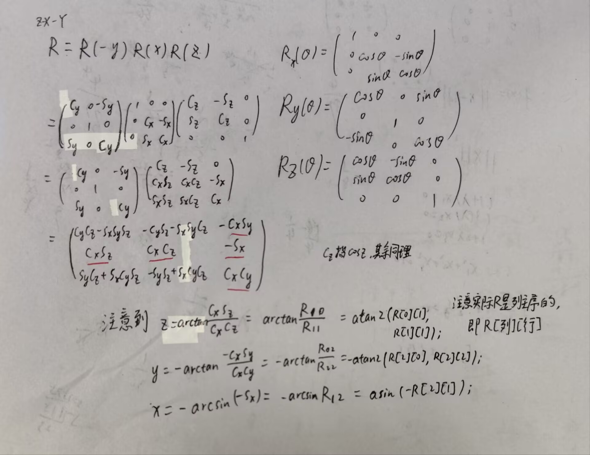

## 如何从旋转矩阵R=R(-y)R(x)R(z)去反解欧拉角xyz？
展开R=R(-y)R(x)R(z)
如图


## 为什么要EulerHint
quat → euler 是多对一的。同一个旋转有无穷多组欧拉表示
| 族 | 形式 | 例子 |
|:---:|:---:|:---:|
| **周期解** | 每个分量加减360°k | (20,30,40)≡(20,390,40)≡(−340,30,40) |
| **翻转解** | (180−x, y+180, z+180) | (20,30,40)≡(160,210,220) |

而 `asin`/`atan2` 每次都只返回一个"规范代表"**（x∈[−90,90]、y,z∈(−180,180]）。这意味着：
- 用户拖到179°再拖一格 → 反解给出−179°，滑块被"拽回去，导致视觉上的跳变

为了解决这个问题，Unity采用EulerHint
思路是每次反解出欧拉角时考虑其**最近的翻转解**和**最近的周期解**
代码如下
```cpp
//将v±(n * 360°)归约到离ref最近的角度
static inline float ToNearestDegree(float v, float ref)
{
    return v + 360.0f * glm::round((ref - v) / 360.0f);
}

//计算最近的欧拉角Hint
glm::vec3 ComputeEulerNearestHint() const
{
    //从旋转矩阵R=R(-y)R(x)R(z)去反解欧拉角xyz
    const glm::mat3 R = glm::mat3_cast(m_LocalRotation);   //列主序:R[列][行]
    const float x = glm::degrees(std::asin(glm::clamp(-R[2][1], -1.0f, 1.0f)));
    const float z = glm::degrees(std::atan2(R[0][1], R[1][1])); //arctan(R10/R11)
    const float y = -glm::degrees(std::atan2(R[2][0], R[2][2])); //arctan(R02/R22)
    const glm::vec3 primary(x, y, z);

    if (!m_HasEulerHint) return primary; //从未编辑过,没参考点

    //有两组候选，分别是primary和翻转值，各自按分量360°吸附到旧hint
    const glm::vec3 flip(180.0f - primary.x, primary.y + 180.0f, primary.z + 180.0f);

    const glm::vec3 a = glm::vec3(ToNearestDegree(primary.x, m_EulerHint.x),
                                    ToNearestDegree(primary.y, m_EulerHint.y),
                                    ToNearestDegree(primary.z, m_EulerHint.z));

    const glm::vec3 b = glm::vec3(ToNearestDegree(flip.x, m_EulerHint.x),
                                    ToNearestDegree(flip.y, m_EulerHint.y),
                                    ToNearestDegree(flip.z, m_EulerHint.z));
    
    const glm::vec3 da = a - m_EulerHint;
    const glm::vec3 db = b - m_EulerHint;
    return (glm::dot(da, da) <= glm::dot(db, db)) ? a : b; //返回更接近旧hint的那组
}
```