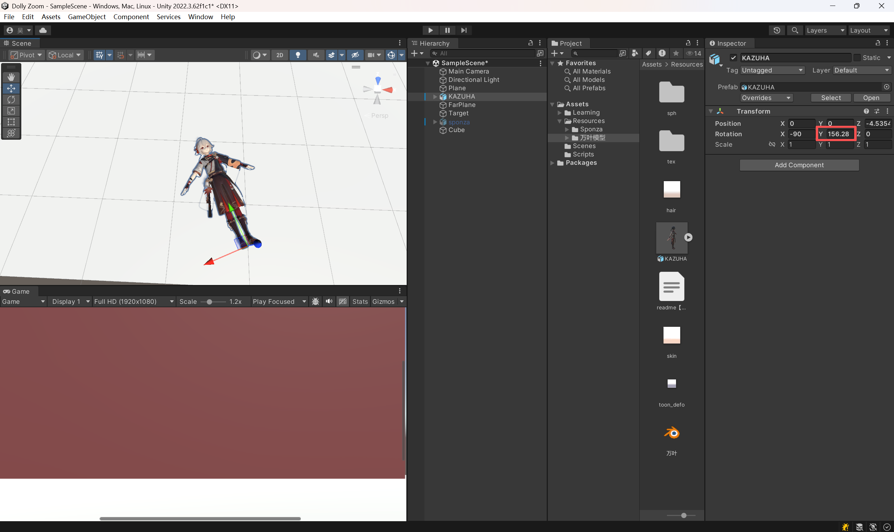
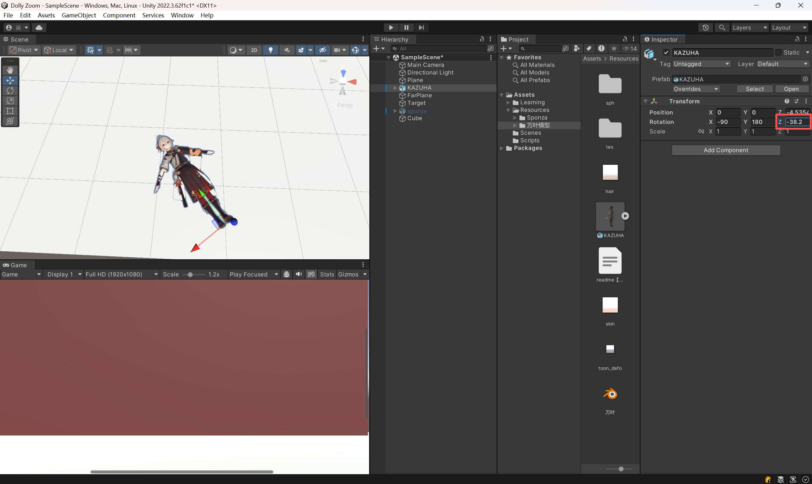

# 欧拉角、四元数与万向锁
- 三维旋转用欧拉角会导致万向锁
  - 原因：以常见的“先绕 X、再绕 Y、再绕 Z”为例：当中间那个角转到约 ±90° 时，前后两个旋转轴会重合，三个自由度退化成了两个自由度，导致了万向锁。此时改变“绕第一个轴”的角度，效果和改变“绕第三个轴”相同，两个操作无法再独立控制——这就是万向锁
    > 可以用旋转矩阵来证明R(X + 90°)R(Y+90°)R(Z) == R(X)R(Y+90°)R(Z + 90°)
- 而四元数就可以解决这个问题
  - 因为四元数用四个数表示：
    q = (w, x, y, z)
    但它必须满足单位长度约束用于表示旋转：
    w^2^ + x^2^ + y^2^ + z^2^ = 1
    所以四个数只有 3 个自由度，仍然描述三维旋转的三个自由度
    因为它没有欧拉角那种轴重合导致的自由度塌缩——这才是它被实际使用的真正理由
- 而采用四元数存储，用四元数/轴+角来旋转都是不错的
- 但是当我们在编写Inspector页面的时候，采用欧拉角三个滑块，显然如果直接每次使用欧拉角来构造四元数是会出问题的，即使Transform中底层存的是四元数
  - 因为这本质上还是在使用欧拉角（每次都通过欧拉角去构造四元数）
- 如何解决？
  - 法一：采用一个不那么常用的轴作为可能失效的导致万向锁的轴来hack，Unity就是这么做的，他采用了Z-X-Y的旋转序，所以会在x=±90°时产生万向锁问题
  如图
  
  
  - 法二：我们知道了通过轴角来旋转四元数是正确的，那么我们便可以在Inspector中保存一个vec3，每次用和上一帧vec3作差算出增量，然后根据对应分量用轴角方式去调用Transform的旋转Rotate(const vec3& axis, float degree)，这样就能避开万向锁问题(吗？)
  那么代价是什么呢
    - 会导致显示出问题(为什么？)
  - 我发现实际上Unity应该是对一二进行了结合，在Inspector里面使用了绝对欧拉，而在Gizmo页面选择了增量旋转

- 以上的理解作为程序员似乎已经足够了，但是上面一直在试图让我们接受一个事情：为什么3D旋转必须要用四个数，还是四个受限的数(模长为一 ||q|| = 1)，而不能用三个实数表达呢？
- 真正数学的解释，事实上涉及拓扑学的知识（我不是数砖的没学过拓扑，仅有线代和高数基础，全靠AI大人解释和我个人的理解的（悲））
- 事实上3维空间确实只需要三个数就能表达物体的状态，这是不错的。但是其实我们讨论的是一个“连续性”的问题，也就是说 **我们能否做到将R^3^完美地、不重复地、毫不失真地一一映射到SO(3)的旋转曲面上**
  > R^3^：三维实数空间，这是一个平坦的、无限延伸的空间
  > SO(3)：Special Orthogonal group of degree 3（三维特殊正交群） ，所有3D旋转的集合，真实存在的旋转状态。这是一个扭曲的、首尾相连的（转360度等于没转）空间
    >1. O (Orthogonal) —— 正交
    >线代里学过，正交矩阵就是满足 R^T^ R = I（转置乘以自己等于单位矩阵）的矩阵。
    >它的几何意义是：保长度、保角度。
    >如果你用一个正交矩阵去乘一个向量，这个向量的长度不会变，向量之间的夹角也不会变。这正是“旋转”和“反射”的特性。
    >2. S (Special) —— 特殊
    >正交矩阵里，有一类矩阵的行列式是 −1，另一类是 +1。
    >行列式为 −1 的正交矩阵：包含“镜像反射”（就像你照镜子，左右互换了）。
    >行列式为 +1 的正交矩阵：纯粹的“旋转”，不包含反射。
    >这里的 S 就是规定：我们只要纯旋转，不要镜像反射。
    >3. 3 —— 三维
    >这是一个 3×3 的矩阵，作用于三维空间。
> 总结一下：
> SO(3) 就是所有 3×3 的、行列式为 1 的正交矩阵的集合。
- 白话地说，也就是我们需要证明**能不能用R^3^这个空间去连续地去包裹SO(3)而不断开**
- 下面我们给出证明：
- 由海涅-博雷尔定理
  > 海涅-博雷尔定理：在欧氏空间中，紧致等价于“有界且闭”
- R^3^是无限延伸的，无界，所以它不紧致。它像一张无限大的、平坦的纸，可以无限延伸
- SO(3)（旋转矩阵集合）：是紧致的。它像一个封闭的、有限的球面，所有的旋转状态都在这个球面上
- 而**紧致性在连续映射下是保持的** (1)
  > 定理：紧致空间的连续像是紧致的。即如果你有一个“封闭且有限”的空间（比如一个球面），你用任何连续的方式把它映射到另一个空间，得到的像（结果）也一定是“封闭且有限”的
- 那么我们便可以得出，如果存在一个R^3^到SO(3)的连续的满射，根据(1)，由于SO(3)是紧致的，则R^3^必然也是紧致的，而R^3^不紧致，所以证伪。即不存在一个R^3^到SO(3)的连续的满射。即必然有不连续的**奇点**，在我们说的欧拉角问题中便是：若以X-Y-Z为旋转序，当Y=90°时，XZ的旋转等效
- 所以我们可以下结论了！
- 在编写Inspector页面的时候，采用欧拉角三个滑块控制旋转必然会导致万向锁！因为不存在连续的满射